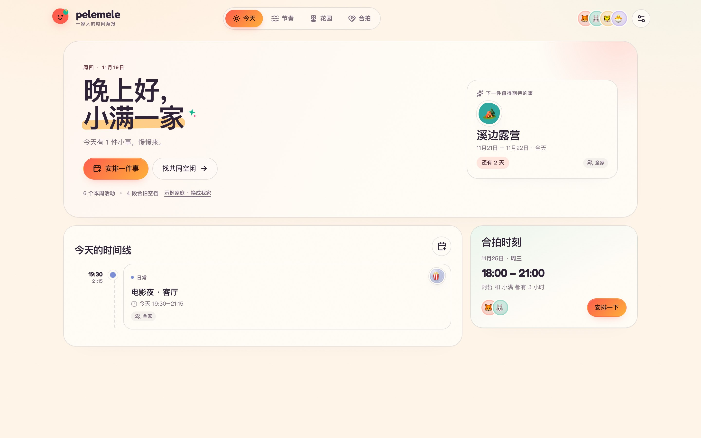
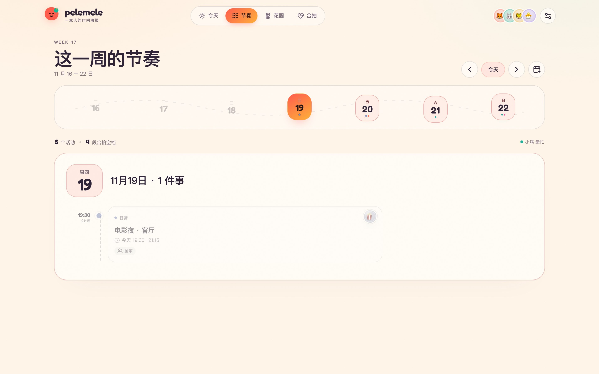
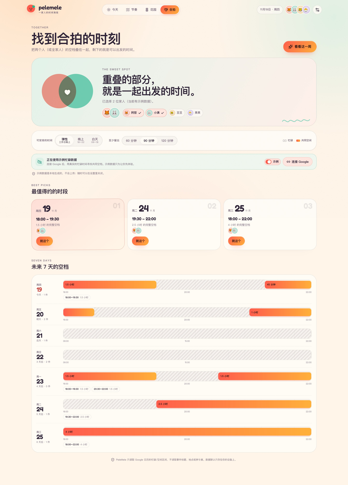
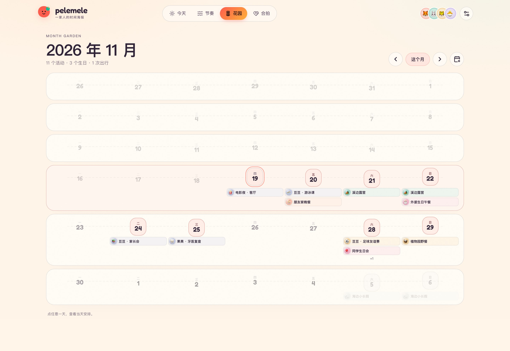
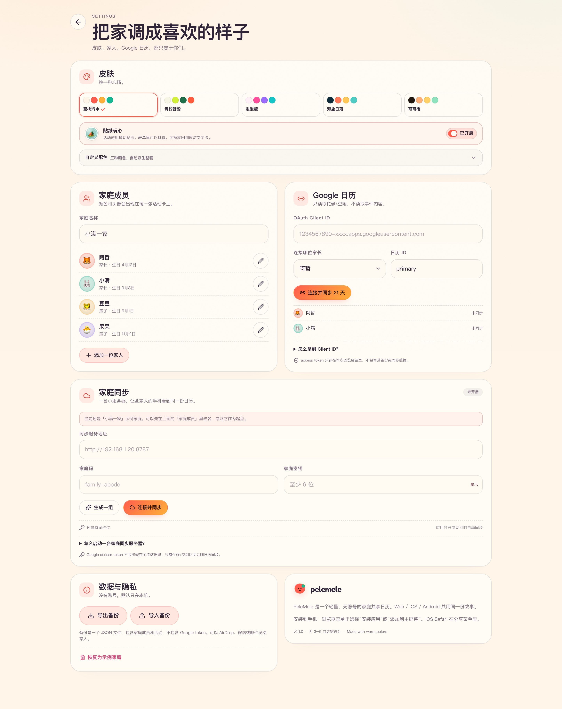
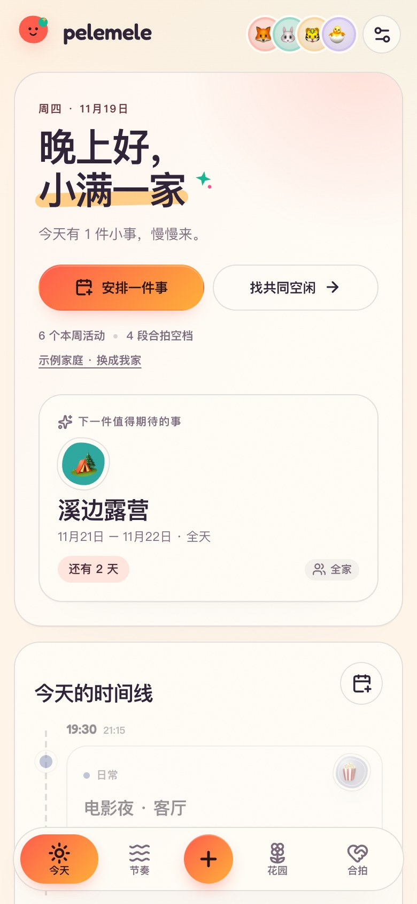
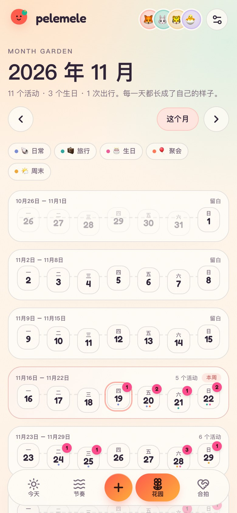
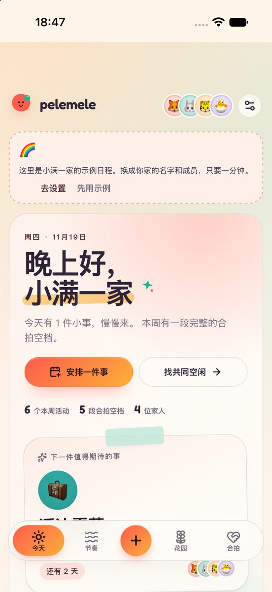
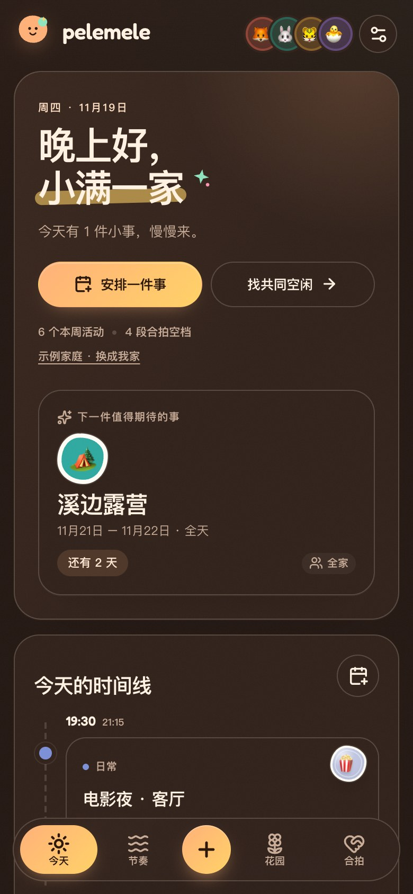

# PeleMele 🎈

> 把一家人的时间，拼成一张温暖的海报。

**在线体验：[https://lulgabc.github.io/PeleMele/](https://lulgabc.github.io/PeleMele/)**  
[](https://github.com/lulgabc/PeleMele/actions/workflows/pages.yml)

PeleMele（法语 *pêle-mêle*，热热闹闹拼在一起）是一个为 3–5 口之家设计的轻量共享日历。
Web / iOS / Android 共用一套代码；不做 Google Calendar 式的表格，而是用「海报、纸带、时间缎带」来讲一家人的时间。

- **今天**：问候、下一件值得期待的事、今天的故事线、合拍空档。
- **节奏**：一条 7 天波浪选择器 + 选中日的纵向故事线。
- **花园**：一个月由 4–6 条「周纸带」组成，日期是纸带上的扣子，而不是格子。
- **合拍**：把父母（或任意成员）的忙碌叠在一起，找出共同空闲，并给出 3 个值得约的时段。
- **皮肤**：蜜桃汽水 / 青柠野餐 / 泡泡糖 / 海盐日落 / 可可夜，外加三色自定义配色。
- **Google 日历**：用最小权限 `calendar.freebusy` 只读取忙碌/空闲，不读取标题、地点和参与者。
- **家庭同步**：可选的零依赖自部署 Node 服务，让多台设备共享同一份日历。



## 快速开始（Web）

**在线版**：<https://lulgabc.github.io/PeleMele/>（GitHub Pages，推送 `main` 自动部署）

```bash
npm install
npm run dev          # http://localhost:5173
npm test             # 36 个单元/组件测试
npm run build        # 产物在 dist/
npm run preview      # 预览生产构建
```

GitHub Pages 的子路径构建：

```bash
VITE_BASE=/PeleMele/ npm run build
```

部署由 `.github/workflows/pages.yml` 完成：`npm ci` → `npm test` → 子路径构建 → 上传 Pages artifact。
仓库 Settings → Pages 的 Source 已设为 **GitHub Actions**；普通推送即可发布。

首次打开会加载「小满一家」的示例日程。点头像进入设置，可以改家庭名称、成员、皮肤，或恢复示例。

### 安装为 PWA

- Android / 桌面 Chrome：地址栏右侧「安装」。
- iPhone Safari：分享 → 添加到主屏幕。iOS 26 起会以独立窗口打开。

## iOS / Android

原生工程已经生成在 `ios/` 和 `android/`，与 Web 使用同一份 `dist/`：

```bash
npm run build
npx cap sync
npx cap open ios       # 需要 Xcode
npx cap open android   # 需要 Android Studio + JDK 17+
```

或：

```bash
npm run cap:ios
npm run cap:android
```

本机验证：`npx cap add ios` / `npx cap add android` 与 `npx cap sync` 均通过；Xcode 27.2 `xcodebuild` 构建 iOS 模拟器 **BUILD SUCCEEDED**，并在 iPhone 17 模拟器安装运行（见截图）。Android 构建需安装 JDK/Android SDK，当前机器未安装 Java。

> 原生壳内的 Google OAuth 受 WebView 限制。当前建议在 Web/PWA 上授权 Google；忙碌区间会通过「家庭同步」到达原生设备。详细取舍见 `docs/RESEARCH.md`。

## 连接 Google 日历

1. 在 [Google Cloud Console](https://console.cloud.google.com/apis/credentials) 新建项目并启用 **Google Calendar API**。
2. 配置 OAuth 同意屏幕（External），把家人加进 **Test users**。
3. 创建 **OAuth Client ID → Web application**。
4. Authorized JavaScript origins 添加：
   - `http://localhost:5173`
   - 你的部署域名（如 `https://pelemele.example.com`）
5. 打开 PeleMele → 设置 → Google 日历，粘贴 Client ID，选择家长，点「连接并同步 21 天」。

权限只申请 `https://www.googleapis.com/auth/calendar.freebusy`。
Access token 只存 `sessionStorage`，关闭标签页即失效；不会进入备份或家庭同步。

> 没有 Client ID 也能完整体验「合拍」：默认开启的示例忙碌数据会在本地生成，且 UI 明确标注「示例」，可随时关闭。

## 家庭同步（可选，自部署）

```bash
node server/index.mjs --port 8787 --data ./server/data
```

- 零依赖，Node 20+；数据是 `server/data/<room>.json`（权限 0600）。
- 家庭密钥用 scrypt 哈希保存，服务端不存明文。
- 客户端在设置 → 家庭同步里填地址、家庭码、密钥；首次同步会创建空间。
- 服务端只同步日历快照（含 Google 忙碌区间），**不同步 Google token**。
- 局域网可用 HTTP；公网请用 HTTPS 反向代理。

接口：

```http
GET /health
GET /api/rooms/:room        x-family-key
PUT /api/rooms/:room        x-family-key  { baseRevision, state }
```

已验证行为：创建 201、读取 200、错误密钥 403、过期 revision 409（返回当前状态供客户端合并）、更新 200 / revision+1。

## 截图

| | |
| --- | --- |
|  |  |
|  |  |
|  |  |
|  |  |

完整截图在 `docs/screenshots/`，Web 为 390×844（2x）与 1440×900（2x）；iOS 为 iPhone 17 模拟器。

## 技术栈

- **React 19 + TypeScript + Vite 8**：同一份 UI 服务 Web/PWA 与 Capacitor 原生壳。
- **Capacitor 8**：iOS / Android 原生工程，后续可接通知、日历写入等原生能力。
- **纯 CSS 设计系统**：5 套皮肤 + 自定义三色派生，CSS 变量、`color-mix`、SVG 手绘元素。
- **date-fns** 只做日期运算；没有 UI 框架，没有后端依赖。
- **自研轻量状态**：`useReducer` + localStorage，实体级 `updatedAt` 合并 + 墓碑删除。
- **零依赖同步服务**：`node:http` + 文件原子写。

## 目录

```
src/
  lib/
    availability.ts   区间合并/差集/交集、共同空闲、冲突检测（纯函数）
    selectors.ts      家庭视图派生数据
    google.ts         Google Identity Services + freeBusy
    sync.ts           家庭同步客户端（拉取/合并/推送/冲突重试）
    themes.ts         皮肤与配色派生
    seed.ts           示例家庭 + 确定性示例忙碌
  components/         UI 组件（布局、卡片、时间线、抽屉…）
  screens/            今天 / 周 / 月 / 合拍 / 设置 / 活动表单
  state/              FamilyContext、UIContext、SyncBridge
  test/               36 个测试（含同步服务端到端）
server/               自部署家庭同步服务
ios/ android/         Capacitor 原生工程
docs/                 研究、设计规范、验收截图
```

## 设计原则

1. **海报，不是表格**：日期是大字，事件是贴纸，周是纸带，空闲是缎带。
2. **一屏回答一个问题**：今天干什么 / 这周什么节奏 / 哪天有故事 / 全家何时合拍。
3. **暖但不幼稚**：奶油纸感、珊瑚/青柠/葡萄紫/深海蓝，大胆的大色块与深色皮肤。
4. **隐私默认**：无账号、本地优先；Google 只读 free/busy；同步密钥只在本机。

更多取舍与竞品分析见 [docs/RESEARCH.md](docs/RESEARCH.md)，视觉规范见 [docs/DESIGN.md](docs/DESIGN.md)。

## 测试与验收

```bash
npm test        # 7 个文件，36 个测试通过
npm run build   # TypeScript 严格检查 + 生产构建通过
```

完整命令输出、iOS 模拟器构建与同步服务 curl 记录见 [docs/VERIFICATION.md](docs/VERIFICATION.md)。

- `availability`：区间运算、两家长交集、家庭活动占用、子活动不占用父母、最小时长、多日范围。
- `reducer`：新增/编辑保留 createdAt、软删除、皮肤、同步合并（含每成员 Google busy 取最新）。
- `dates`：周一起始、月纸带、跨日活动、全天范围 off-by-one。
- `storage`：备份往返、裸状态导入、异常文件拒绝、缺省字段补全。
- `google`：freeBusy 请求体/token 头、忙碌区间映射、401 过期提示、无权限错误。
- `App`：首屏渲染、导航到花园、快速添加活动、从月视图打开某天。

浏览器控制台错误为 0（Playwright 在 390×844 与 1440×900 下巡检）。

## 已知边界

- Google OAuth 需要自备 Web Client ID；未配置时使用明确的示例忙碌数据。
- 原生壳内的 Google 授权暂未接入系统浏览器 + PKCE（见 RESEARCH 风险与对策）；原生端可通过家庭同步获得已授权的忙碌区间。
- 家庭同步是「打开/切回/编辑后」的最终一致同步，不是实时协同；冲突按实体 `updatedAt` 合并，删除使用墓碑。
- 颜色派生依赖 `color-mix()`（iOS 16.4+ / 现代 Chrome）；更老的 WebView 会退化为部分纯色。

---

Made with warm colors. 为 3–5 口之家设计。
